# Wavey RaptorQ kept added p99 latency to 17–23 ms in long-haul 4K tests

On the same two routes with 1% injected random packet loss, **SRT and RIST added 293–1,033 ms at p99** with the tested receive buffers. All three transports delivered every frame on time.

**Loss caveat.** At 165.1 Mb/s, FEC-only RaptorQ missed more frames than plain librist and libsrt during bursts and recurring 20 ms outages. It carried every frame through sustained 1% and 5% random loss when repair was sized for those rates. Adding whole-frame retransmission (ARQ) cleared the tested burst and recurring-outage cases at 30–250 ms RTT, with extra delay on repaired frames.

**24 November 2026 · 972 direct transport cases · Dedicated Linode hosts**

Wavey’s RQD2 transport groups each video frame into a block, identifies its packets, and uses standard RaptorQ forward error correction. When enough symbols arrive, the receiver can reconstruct the frame without waiting for a network round trip. On the 4K profile here, the 32-byte Wavey header accounts for about 2.4% of the UDP payload, alongside a 4-byte RaptorQ symbol identifier and a 1,316-byte symbol. [RaptorQ standard](https://www.rfc-editor.org/rfc/rfc6330.html), [Wavey wire format](https://github.com/wavey-ai/raptor-fec/blob/90f0fdda25c150bf266048a9d3821998848aad3b/README.md)

The standalone `transport-bench` harness sent the same H.264 video through each adapter, one transport at a time. The results measure direct transport and frame completion. The [deployed Needletail mesh results](../../2026-11-22-4k-against-cloudflare-and-livekit.md) are a separate set of tests.

[Real routes](#latency-on-real-routes) · [Loss and recovery](#what-happened-when-losses-clustered) · [Test coverage](#test-coverage) · [Every case](#case-atlas) · [Method and provenance](#method-and-provenance)

## Latency on real routes

On real London-to-Newark and London-to-Sydney paths, all three transports delivered all 360 frames on time at 247.9 Mb/s with 1% injected random loss. RaptorQ added **17–23 ms at p99**. SRT and RIST added about **293–301 ms** to Newark and **1,024–1,033 ms** to Sydney with the configured receive buffers.

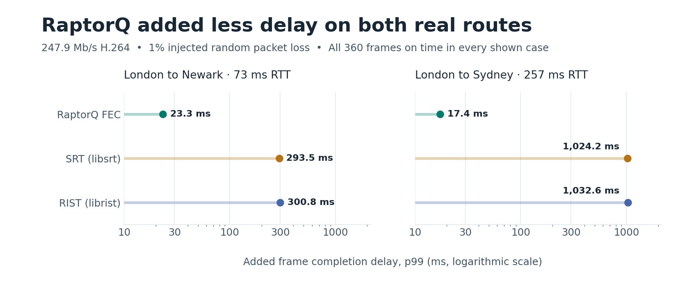

| Transport | Newark added p99 | Sydney added p99 | Extra sender wire bytes |
| --- | ---: | ---: | ---: |
| RaptorQ FEC | 23.3 ms | 17.4 ms | 9.23% |
| SRT, libsrt 1.5.7 | 293.5 ms | 1,024.2 ms | 7.84–7.86% |
| RIST, librist 0.2.20 | 300.8 ms | 1,032.6 ms | 8.73% |

Added delay is frame completion time above the measured UDP path delay and the frame's estimated serialization time. It includes transport buffering. Sender wire overhead counts packet headers, transport repair, and the adapters' different packaging. The real-route counters also include control traffic, which the local sets measure separately. The real-path cells used FEC-only RaptorQ. [Set G case results](case-results.csv)

## What happened when losses clustered?

At 165.1 Mb/s, FEC-only RaptorQ delivered all frames on time at 1% and 5% independent packet loss across the 30, 100, and 250 ms RTT cases. Its repair budget was sized from the configured loss rate. The same build missed up to **11 of 360 frames** under burst loss and **7 of 360** during recurring 20 ms outages. RIST and SRT recovered every frame in those 20 ms outage cells.

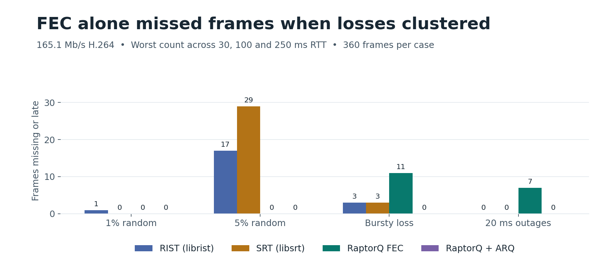

RaptorQ with whole-frame ARQ recovered all frames in those same cases at RTTs of 30–250 ms. Its added p99 was **58–275 ms** under burst loss and **96–315 ms** during the recurring outages. The hybrid used a longer deadline than FEC alone. At 1 ms RTT, its 40 ms deadline was shorter than its 50 ms repeat-request interval, and the wider matrix still recorded misses. The recurring outages aligned with IDR keyframes in this clip. Losing an IDR can disrupt playback beyond that frame. [Set A case results](case-results.csv)

## How did the transports recover from longer outages?

The single-outage test used a 100 ms RTT, an 80.9 Mb/s stream, and a 400 ms configured latency budget for all four implementations shown. Plain RIST, plain SRT, and hybrid RaptorQ recovered every frame after the 50 and 200 ms outages. The one-second outage exposed a different trade-off. Hybrid RaptorQ had the fewest deadline misses, while plain SRT returned to steady delivery sooner.

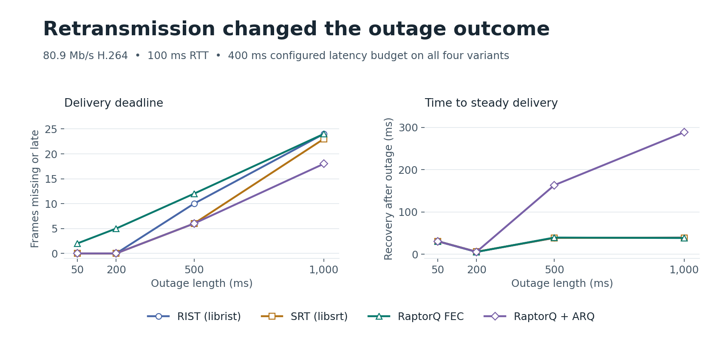

| One-second outage | Frames missing | Delivered late | Total missing or late | Back to steady delivery |
| --- | ---: | ---: | ---: | ---: |
| RaptorQ FEC | 24 | 0 | 24 | 38 ms |
| RaptorQ + whole-frame ARQ | 1 | 17 | 18 | 289 ms |
| SRT, libsrt | 2 | 21 | 23 | 39 ms |
| RIST, librist | 24 | 0 | 24 | 39 ms |

Recovery time starts when the outage ends. A stream can resume steady delivery quickly after skipping missing frames. This is why recovery time and deadline misses are shown together. [Set D case results](case-results.csv)

## Test coverage

The 972 cases cover 13 adapter variants and seven sets. The table counts completed measurements and transport failures. The additional RaptorQ client and contributor profiles contributed 36 cases to B and 32 to G.

| Set | Cases | Conditions tested |
| --- | ---: | --- |
| [A · Loss and delay](#a--delay-across-round-trip-times) | 420 | Two video rates, four RTTs, clean traffic, 1% and 5% random loss, bursts, and recurring outages |
| [B · Throughput](#b--throughput-ladder) | 216 | Six rates from 5.6 to 333.5 Mb/s, a clean 1 ms RTT path, and 1% loss at 30 and 250 ms RTT |
| [C · Buffer and repair](#c--buffer-time-and-repair-overhead) | 112 | Four latency settings or four repair allocations at 80.9 Mb/s, 30 and 250 ms RTT, 1% and 5% loss |
| [D · Single outages](#how-did-the-transports-recover-from-longer-outages) | 32 | Four outage durations from 50 ms to 1 s at 100 ms RTT |
| [E · Jitter](#e--jitter-and-packet-reordering) | 28 | 5 ms of jitter, two rates, clean and 1% random loss, SRT reorder tuning |
| [F · Fan-out](#f--one-sender-and-many-receivers) | 20 | Four stream-rate and receiver-count combinations, from 10 to 100 receivers |
| [G · Real routes](#g--long-haul-routes-and-endpoint-profiles) | 144 | London to Newark and Sydney, four rates on each route, with and without 1% injected loss |

### A · Delay across round-trip times

At 165.1 Mb/s with 1% random loss, FEC-only RaptorQ added **12.7–16.1 ms at p99** across the 30, 100, and 250 ms RTT cases. The buffered RIST and SRT configurations added about **117–124 ms** at 30 ms RTT, **398–404 ms** at 100 ms, and **997–1,006 ms** at 250 ms. At 30 ms RTT, the librist case missed one frame deadline. The figure keeps latency and delivery status visible together.

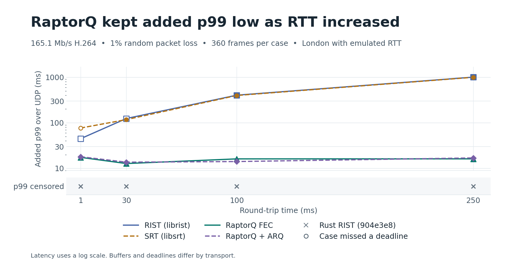

### B · Throughput ladder

At 1% loss and both 30 and 250 ms RTT, the loss-sized RaptorQ mesh profile and the hybrid delivered all frames on time at **all six tested rates**, up through 333.5 Mb/s. At the top rate, FEC-only RaptorQ added **22.8 and 25.1 ms at p99**, respectively. Plain SRT delivered all frames at the top rate at 250 ms RTT and missed two deadlines at 30 ms. Some variants failed at lower rungs and passed higher ones, so the full ladder matters when sizing a link. [Set B case matrix](case-matrix-b.png)

### C · Buffer time and repair overhead

At 80.9 Mb/s with 5% random loss, raising fixed RaptorQ repair from 5% to 10% closed all frame gaps at both RTTs. Higher repair allocations also passed, with more bytes on the wire.

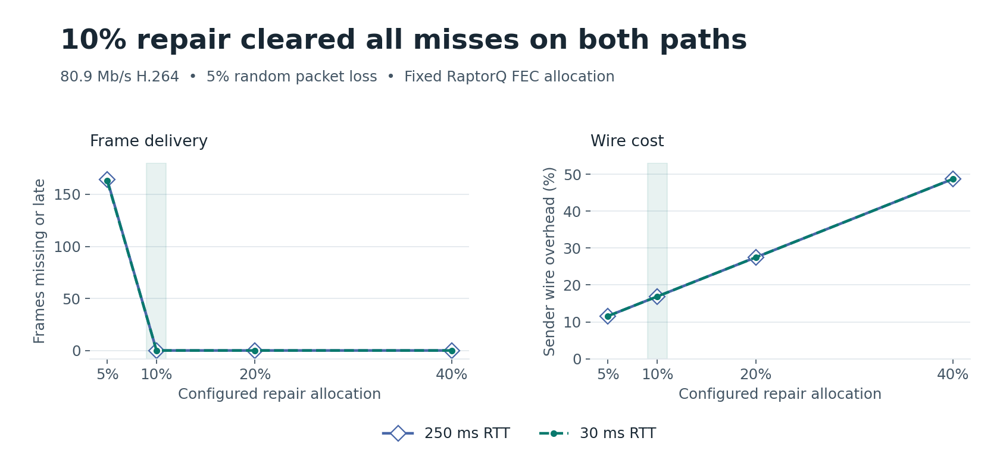

| Fixed RaptorQ repair allocation | Misses at 30 ms RTT | Misses at 250 ms RTT | Sender wire overhead |
| --- | ---: | ---: | ---: |
| 5% | 163 of 360 | 164 of 360 | 11.6% |
| 10% | 0 | 0 | 16.9% |
| 20% | 0 | 0 | 27.5% |
| 40% | 0 | 0 | 48.7% |

With 10% repair, added p99 was **11.2 ms at 30 ms RTT** and **9.8 ms at 250 ms RTT**. For the same 5% loss, librist first delivered all frames on time at 180 and 1,500 ms of configured buffering, respectively. Plain SRT also needed 1,500 ms at 250 ms RTT and still missed four deadlines at the largest tested buffer on the 30 ms RTT path. [Set C case matrix](case-matrix-c.png)

The matched set A case at 165.1 Mb/s, 100 ms RTT, and 1% random loss shows the compute trade-off. All four configurations delivered every frame on time. CPU figures are process cores per Gb/s of source media.

| Transport | Sender CPU | Receiver CPU | Sender wire overhead |
| --- | ---: | ---: | ---: |
| RaptorQ FEC | 0.95 | 0.74 | 9.5% |
| RaptorQ + whole-frame ARQ | 0.99 | 0.72 | 9.5% |
| SRT, libsrt | 0.75 | 0.35 | 7.9% |
| RIST, librist | 0.73 | 0.80 | 8.7% |

### E · Jitter and packet reordering

At 165.1 Mb/s with 1% random loss, 5 ms of jitter, and 30 ms RTT, FEC-only RaptorQ completed all frames on time and added **20.6 ms at p99**. Librist missed six deadlines. SRT's default configuration missed one. Allowing 64 packets of reordering brought that SRT case to zero misses with **123.3 ms of added p99 delay**. The tested SRT FEC filter missed 209 deadlines in that cell. [Set E case matrix](case-matrix-e.png)

### F · One sender and many receivers

At just under 5.6 Mb/s per receiver, the loss-sized RaptorQ mesh profile kept **90 of 100 receivers** fully on time. At 24.9 Mb/s per receiver, every tested variant had **zero of 100 receivers** fully on time. Several variants saturated the lab's VLAN at that rate, and four adapters reported a transport failure. This was direct fan-out from one sender at 30 ms RTT and 1% random loss. [Set F case matrix](case-matrix-f.png)

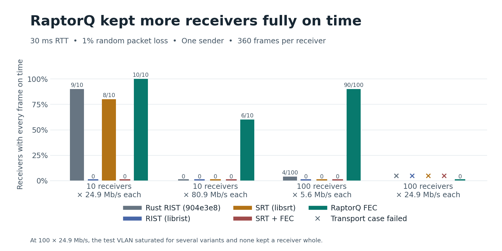

### G · Long-haul routes and endpoint profiles

Loss-sized RaptorQ, the RaptorQ client profile, librist, and plain SRT each met the deadline for every frame across all 16 cells. The contributor profile, capped at 16 repair symbols per block, passed 12 of 16 and missed 19–21 frames at the top rate with injected loss. The RaptorQ profile used for a mesh hop and the one used for contribution have different repair budgets. [Set G case matrix](case-matrix-g.png)

## Case atlas

Each cell represents one recorded case. The matrices show missing or late frames at the worst receiver, so a fan-out cell can reveal a single receiver falling behind. The same scale is used throughout. The five transport failures have their own mark, and gray cells were outside the test plan.

A · Loss and delay · 420 cases

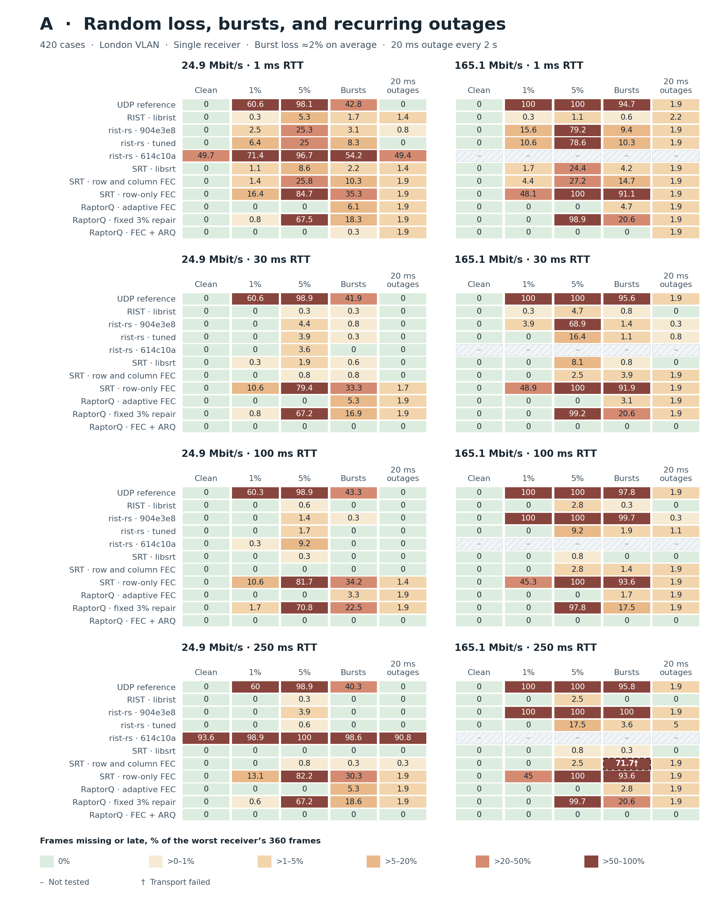

B · Throughput ladder · 216 cases

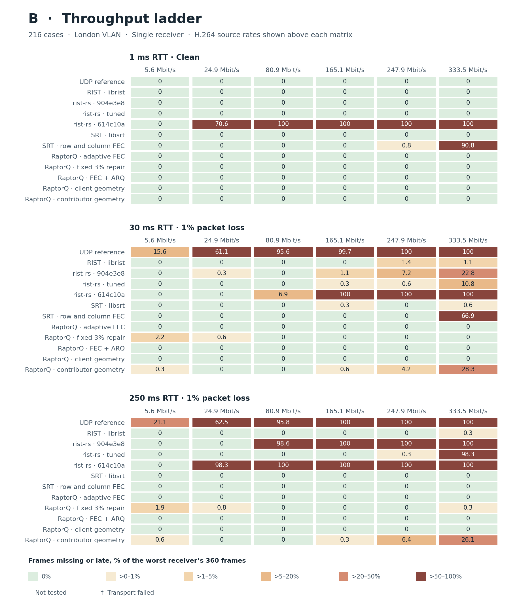

C · Buffer and repair sweep · 112 cases

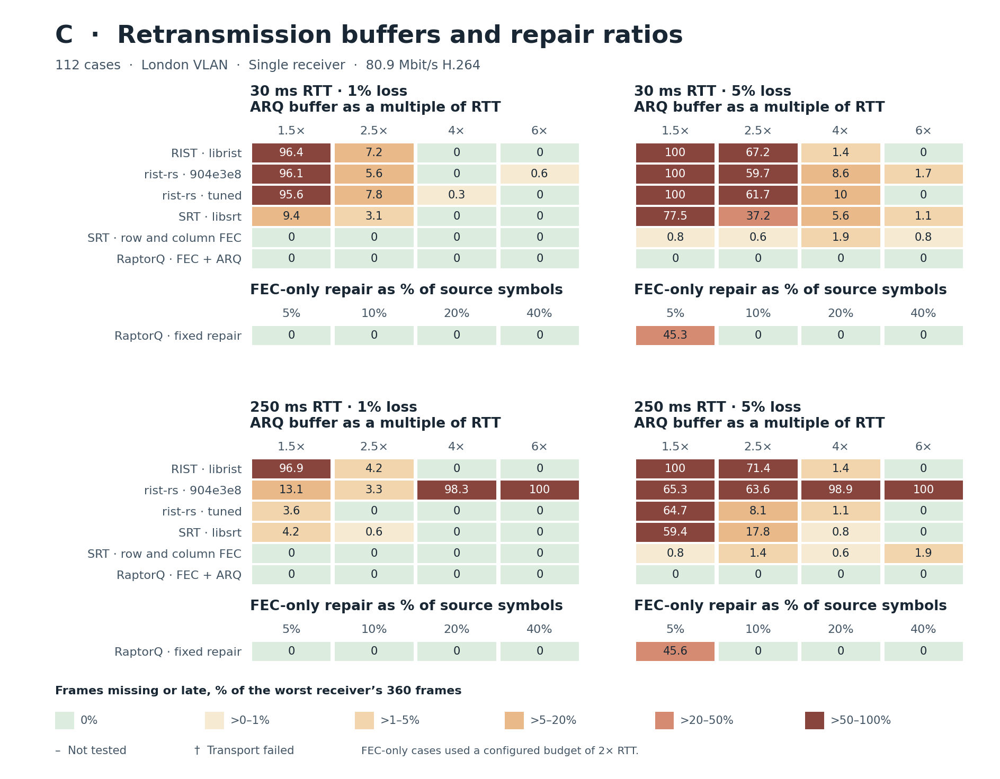

D · Single outages · 32 cases

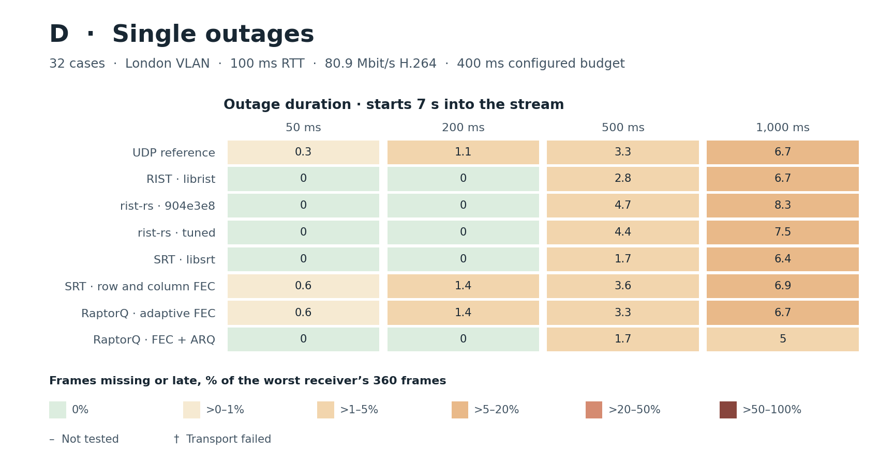

E · Jitter and reordering · 28 cases

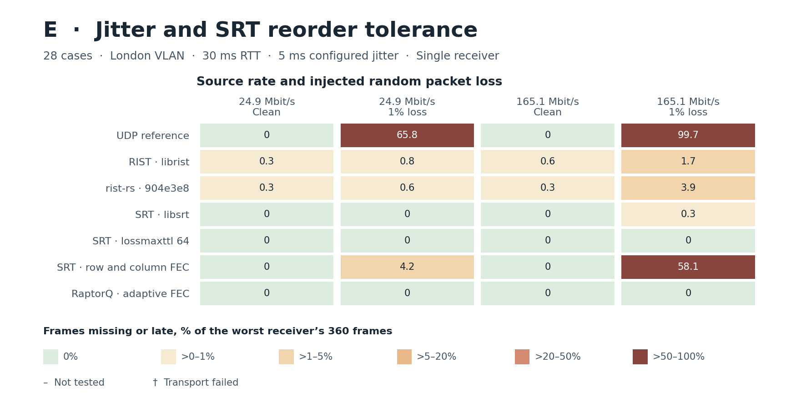

F · Fan-out · 20 cases

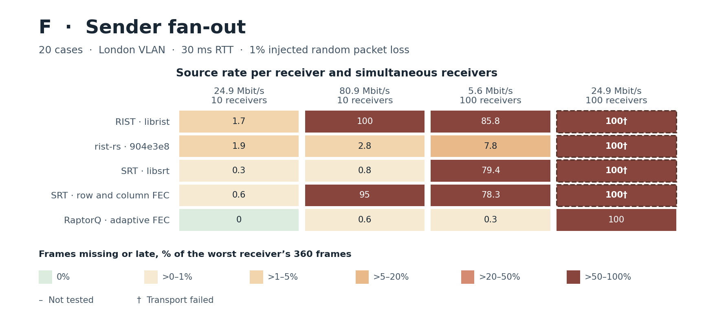

G · Real routes · 144 cases

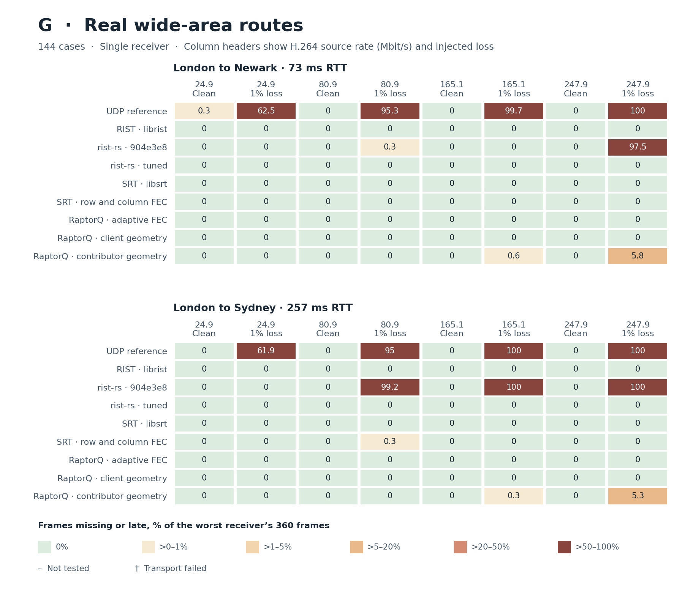

## Method and provenance

| Item | Setting |
| --- | --- |
| Source | 3840×2160 H.264 at 24 fps, 48-frame GOP, no B-frames. Most cases use a 15-second window of 360 frames per receiver. |
| Hosts | Separate dedicated-16 sender and receiver in London, with dedicated-8 receivers in Newark and Sydney. London VLAN paths used network emulation. The two long routes used real RTTs with loss injected at both ends. |
| RIST and SRT | librist 0.2.20 in Main profile and libsrt 1.5.7 in live mode. Both carried MPEG-TS. The main comparison uses retransmission without SRT's optional FEC filter. Other SRT modes are in the case data. |
| RaptorQ | RaptorQ 2.0.1 and `raptorq-datagram-fec` 0.1.6. One fMP4 fragment per frame. Repair was sized from the test's loss rate. The hybrid also requests a whole missing frame. |
| Default latency settings | RIST, SRT, and hybrid RaptorQ used max(4× RTT, 40 ms). FEC-only RaptorQ used max(2× RTT, 40 ms). The buffer and single-outage sweeps set explicit budgets. |
| Scoring | Missing and late frames are counted together for deadline comparisons. Of 972 cases, 561 carried every frame on time and 306 had a censored added p99 because of missing frames. A finite p99 can still come from a case with late frames. The case table retains both the deadline outcome and the timing. |

These measurements describe the tested implementations, settings, and media. They are based on short cells and provide no endurance or decoder-output measurement. Real-path testing covered FEC-only RaptorQ. The hybrid's loss results come from the emulated paths. Later RIST and SRT work ran separately against historical baselines. The newer Rust RIST run tested `cbf19d8`. The Rust SRT follow-up tested av-rs `346b9ba` and reused the 24 November libsrt results. [Rust RIST follow-up](https://github.com/wavey-ai/rist-rs/blob/f1be8f8/benchmarks/2026-11-26-librist-parity/README.md), [Rust SRT backends and interop](https://github.com/wavey-ai/av-rs/blob/c770dda/srt/README.md)

## Evidence and figure reproduction

The public case table contains one row for each of the 972 cases, including five transport failures. The archive manifest identifies the binaries, dependency versions, topology, and case attempts. It records local harness modifications at the test revision. The full captures are retained under `tbench-linode-20261124` in the Linode run archive. [Case results CSV](case-results.csv), [sanitized manifest](manifest.json), [original run manifest](https://github.com/wavey-ai/rist-rs/blob/f1be8f8/benchmarks/2026-11-26-librist-parity/manifests/baseline-20261124.json)

With Matplotlib installed, run `python3 render_charts.py`, `python3 render_tradeoff_charts.py`, and `python3 render_case_atlas.py` in this directory to regenerate the figures from the published case results.
